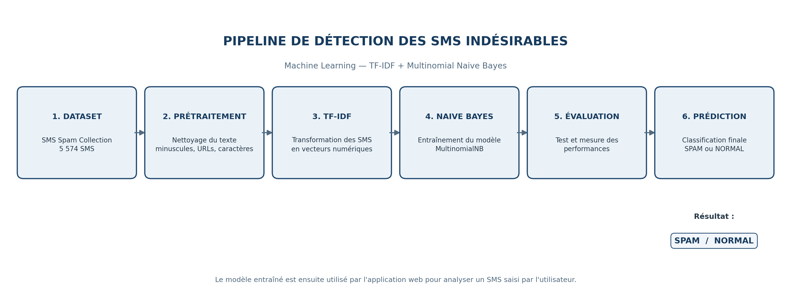

# Détection des SMS indésirables avec l'intelligence artificielle

## Description du projet

Ce projet consiste à développer une application basée sur l'intelligence artificielle capable de détecter automatiquement les SMS indésirables (SPAM) et de les distinguer des messages normaux (HAM).

## Objectifs

- Identifier les SMS indésirables.
- Classifier automatiquement les messages.
- Développer une interface web simple et interactive.
- Mettre en pratique les techniques de Machine Learning.

## Technologies utilisées

- Python
- Pandas
- Scikit-learn
- TF-IDF
- Naive Bayes
- Gradio
- Git et GitHub
- Hugging Face Spaces

## Architecture du projet

```text
detection-spam-sms/
├── data/
├── models/
├── src/
├── app.py
├── requirements.txt
├── README.md
└── .gitignore
```

## Fonctionnement

1. Saisie d'un SMS.
2. Prétraitement du texte.
3. Vectorisation avec TF-IDF.
4. Classification par le modèle Machine Learning.
5. Affichage du résultat : SPAM ou NORMAL.

## Pipeline
## Architecture du Pipeline


### Explication des étapes

1. **Dataset :** collecte des 5 574 SMS.
2. **Prétraitement :** nettoyage et normalisation des messages.
3. **TF-IDF :** transformation des textes en données numériques.
4. **Naive Bayes :** entraînement du modèle de classification.
5. **Évaluation :** mesure des performances du modèle.
6. **Prédiction :** identification d'un SMS comme SPAM ou NORMAL.
